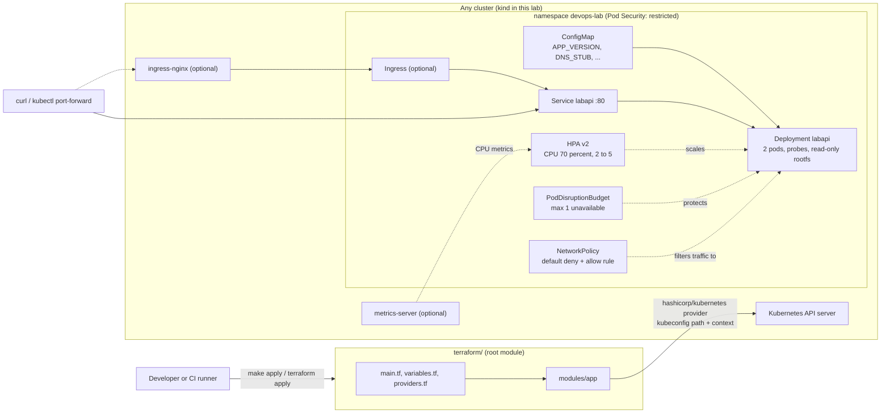

# Architecture

This is a small lab, so the architecture is deliberately small: one service, one Terraform root module that calls one local module, and a throwaway kind cluster.

## Request path

- Through `kubectl port-forward svc/labapi`: used by `make test` and by CI. No ingress controller needed.
- Through ingress-nginx: optional. `make ingress` installs it, `enable_ingress=true` adds the Ingress, and kind maps host port 8081 to the control-plane node.

## The service

`GET /healthz` (liveness), `GET /readyz` (readiness, 503 until startup has finished), `GET /version`, `GET /api/dns?domain=...` (A, MX and TXT via dnspython, 2 second budget per lookup, strict hostname validation) and `GET /metrics` (Prometheus text format: request count and latency by route template, DNS lookup outcomes, build info).

With `DNS_STUB=true` the app answers from a small built-in table (`example.com`, `a-only.example.com`, a name that always times out, everything else NXDOMAIN). That is what CI uses, so the end-to-end test needs no outbound DNS. The real resolver path is covered by unit tests with a mocked dnspython, not by the cluster test.

## Decisions and trade-offs

- **kind instead of a cloud cluster.** The goal is a lab anyone can run for free in a few minutes, and CI can create one on a hosted runner. The cost: no cloud load balancer, no real node pools, and a single worker so the topology spread and PDB rules are present but cannot show their effect.
- **`hashicorp/kubernetes` provider instead of Helm or raw manifests.** It makes the Terraform resource model visible (every probe, security field and policy is an explicit block) and it targets any cluster through a kubeconfig path and context. The cost: Terraform is not the usual tool for managing in-cluster workloads. Many teams would use Helm, Kustomize or a GitOps controller for this layer and keep Terraform for the cluster and cloud resources.
- **Default context is `kind-tfk8s-lab`.** A plain `terraform apply` can only reach the lab cluster unless you change the variable on purpose.
- **One local module (`modules/app`), no registry modules.** One workload does not justify more layers. The module boundary is there to show inputs, validation and outputs. It is not a reusable library yet.
- **Replica count is owned by the HPA after the first apply.** The Deployment uses `ignore_changes` on `spec[0].replicas`. The cost: changing `replicas` in tfvars later has no effect on an existing Deployment. Without this, every apply would reset the HPA's decision.
- **PDB uses `maxUnavailable: 1`, not `minAvailable: 1`.** With a single replica, `minAvailable: 1` would block node drains forever.
- **Pod Security Admission `restricted` on the namespace.** The pod already meets it (non-root, no privilege escalation, all capabilities dropped, seccomp `RuntimeDefault`), so the cluster itself rejects regressions, not just CI.
- **No `HEALTHCHECK` in the Dockerfile.** Kubernetes runs the startup, liveness and readiness probes; a second health mechanism would only be a place to drift.
- **Config changes roll the pods.** The pod template carries a hash of the ConfigMap data, because environment variables are only read at container start.
- **Trivy scans the live objects as well as the Terraform.** Trivy has no checks for `kubernetes_*` Terraform resources (checked locally against a deliberately insecure example), so the e2e job exports the created Deployment and Service as YAML and scans that.
- **CI downloads Trivy and hadolint from pinned releases and verifies a SHA-256.** Third-party scanner actions are another dependency to trust; a checksum-verified release binary is simple and auditable.
- **Network policy is created but enforcement is not tested.** Whether it is enforced depends on the CNI. The lab checks that the objects exist with the right shape, not that packets are dropped.

## What a production setup would add

- **Remote state with locking** (for example S3 plus DynamoDB or a Terraform Cloud/OpenTofu backend), separate state per environment, and a reviewed plan step before apply.
- **Cluster provisioning in code** (EKS/GKE/AKS or Hetzner/Talos) in a separate stack from the workloads, with the provider configured from the cluster outputs rather than a kubeconfig file.
- **TLS on the ingress** via cert-manager and an ACME issuer, plus HSTS and sane timeouts. Note that the upstream ingress-nginx project has been retired (best-effort maintenance ended in March 2026), so a new setup should evaluate Gateway API implementations instead. It is used here only because the optional ingress is a lab convenience.
- **Secrets from a real store** with External Secrets Operator or Secrets Store CSI. This lab has no secrets and therefore no Secret resource.
- **Image supply chain**: push to a registry, pin by digest, scan with Trivy or Grype, sign with cosign and verify at admission (Kyverno or a policy controller), generate an SBOM.
- **Observability stack**: Prometheus Operator `ServiceMonitor`, dashboards, alert rules and SLOs for the endpoints this service already instruments; structured logs shipped off-cluster.
- **Egress NetworkPolicy** (this lab only restricts ingress), resource quotas and limit ranges per namespace, and a dedicated ServiceAccount with no token.
- **Rate limiting and authentication** in front of `/api/dns`. As written it is an unauthenticated lookup proxy and should not be exposed to the internet.
- **Release flow**: tagged images, a promotion path, and drift detection on a schedule.
